# ⚡ Fault-Tolerant, High-Throughput Webhook Ingestion Engine

[](https://www.typescriptlang.org/)
[](https://www.fastify.io/)
[](https://redis.io/)
[](https://www.postgresql.org/)
[](https://prometheus.io/)
[](https://vitest.dev/)

> **A production-grade, multi-tenant Webhook Ingestion & State Reconciliation Engine designed for e-commerce scale (Shopify, TikTok Shop, Shopee). Built with two-phase delivery durability, out-of-order partial payload hydration, tenant-level lease semaphores, shuffle sharding, safe MINID stream trimming, and automated dead-letter queue (DLQ) replay.**

---

## 🏗️ Architecture Overview

```mermaid
flowchart TD
    subgraph External_Platforms["External Platforms"]
        A1["Shopify Webhooks"]
        A2["TikTok Shop Webhooks"]
        A3["Shopee Webhooks"]
    end

    subgraph Ingestion_Gateway["Ingestion Gateway (Fastify)"]
        B1["Raw Body HMAC Verifier<br/>crypto.timingSafeEqual"]
        B2["Multi-Tier Tenant Cache<br/>L1 In-Memory + L2 Redis + Pub/Sub"]
        B3["Token Bucket Rate Limiter<br/>Redis Lua"]
        B4["Shuffle Sharding Router<br/>Power of Two Choices"]
    end

    subgraph Messaging_Buffer["Messaging Buffer (Redis Streams)"]
        S0["Shard 00"]
        S1["Shard 01"]
        SN["Shard 15"]
        PEL["Background XAUTOCLAIM Loop<br/>Zombie PEL Rescue"]
    end

    subgraph Worker_Pool["Worker Pool (Concurrent Consumers)"]
        W1["Worker 1"]
        W2["Worker 2"]
        WN["Worker N"]
    end

    subgraph State_Durability["State & Durability Layer"]
        L1[("Redis: Two-Phase Lease Lock<br/>LOCKED vs DONE")]
        L2[("Redis: ZSET Semaphore<br/>Crash-Safe Tenant Concurrency")]
        DB1[("PostgreSQL: idempotency_keys<br/>PARTITION BY HASH")]
        DB2[("PostgreSQL: entity_states<br/>Weighted FSM + JSONB Hydration")]
        DB3[("PostgreSQL: webhook_events<br/>PARTITION BY RANGE")]
    end

    subgraph Downstream_Services["Downstream Services"]
        ERP["Downstream ERP / WMS API<br/>X-Idempotency-Key Header"]
    end

    A1 -->|POST /webhooks/shopify| B1
    A2 -->|POST /webhooks/tiktok| B1
    A3 -->|POST /webhooks/shopee| B1
    B1 --> B2
    B2 --> B3
    B3 --> B4
    B4 -->|"XADD Shorter Shard -> 202 Accepted"| S0
    B4 -->|"XADD Shorter Shard -> 202 Accepted"| S1
    B4 -->|"XADD Shorter Shard -> 202 Accepted"| SN
    S0 -->|XREADGROUP| W1
    S1 -->|XREADGROUP| W2
    SN -->|XREADGROUP| WN
    PEL -.->|"Rescue Stale PEL Messages"| W1
    PEL -.->|"Rescue Stale PEL Messages"| W2
    PEL -.->|"Rescue Stale PEL Messages"| WN
    W1 <--> L1
    W1 <--> L2
    W1 <--> DB1
    W1 <--> DB2
    W1 <--> DB3
    W1 -->|Dispatch Merged State| ERP
    W2 -->|Dispatch Merged State| ERP
    WN -->|Dispatch Merged State| ERP
```



---

## 🌟 Core Engineering Differentiators

### 1. Two-Phase Delivery Durability: Prevention of Downstream Loss
A common distributed systems pitfall is marking messages as completed inside a database transaction before calling downstream APIs. If the downstream ERP fails (5xx, network timeout), retried messages are falsely treated as duplicates and silently dropped.
* **Stage 1 (Local Ingestion & OCC State Upsert):** The incoming webhook is validated, merged via optimistic state machine, and committed to PostgreSQL with `status = 'PERSISTED'` and `delivery_status = 'QUEUED'`.
* **Stage 2 (Downstream Delivery & Acknowledgment):** The merged state is dispatched to the downstream ERP with a 4-second timeout.
  * **On 2xx Success:** Status transitions to `COMPLETED` and `DELIVERED`. The stream message is acknowledged (`XACK`).
  * **On 5xx / Network Timeout:** The status remains `PERSISTED` (ensuring subsequent attempts do **not** trigger duplicate suppression). The event is scheduled via `delayedRetryScheduler` (Redis ZSET with exponential backoff + full jitter).
  * **On 4xx Client Error or Retry >= 5:** Routed directly to `DLQ` (`webhook_events.delivery_status = 'DLQ'`).

### 2. Safe MINID Stream Trimming & Active Backpressure
Blind truncation (`XTRIM MAXLEN`) discards unconsumed messages during burst spikes, while un-trimmed streams cause Redis to hit `maxmemory` under `--maxmemory-policy noeviction`.
* **Safe MINID Calculation:** The background `SafeStreamTrimmer` derives the safe trimming boundary using the oldest unacknowledged message in the Pending Entries List (`XPENDING key webhook_workers`). If the PEL is clear, it trims up to `last-delivered-id`.
* **True Backlog Backpressure:** Gateway backpressure inspects active unconsumed queue depth (`XPENDING`) rather than cumulative historical `XLEN`, rejecting traffic (`503 Service Unavailable + Retry-After`) only when actual worker lag exceeds capacity.

### 3. Out-of-Order Event Resolution: Weighted FSM + Bidirectional JSONB Hydration
When an `ORDER_CANCELLED` event (weight 99, containing only `{ order_id: 123, cancel_reason: "fraud" }`) arrives **before** a delayed `ORDER_CREATED` event (weight 10, containing full line items and customer address):
* Standard databases either discard late events or blindly overwrite, resurrecting cancelled orders.
* REA's atomic SQL engine dynamically inverts PostgreSQL's `||` JSONB merge operator:
  * Higher-weight payload is placed on the **right** of `||` to preserve terminal state (`CANCELLED`).
  * Lower-weight event is merged on the **left** of `||` to hydrate missing attributes without regressing order status.
  * If a stale event arrives, `is_stale_ignored` evaluates to `true`, suppressing downstream delivery and recording metrics.

### 4. Crash-Proof Resource Isolation: ZSET Lease Semaphores
* Standard counters (`INCR/DECR`) leak when workers crash or encounter OOM (`SIGKILL`), permanently exhausting tenant quotas.
* Concurrency is managed via Redis `ZSET` leases where `score = now + lease_ttl`. Expired leases are atomically pruned via `ZREMRANGEBYSCORE` on every acquisition.

### 5. Head-of-Line Blocking Elimination: Shuffle Sharding (Power of Two Choices)
* To prevent flash-sale merchants from starving smaller merchants, each tenant is deterministically assigned two shards.
* Incoming requests are dynamically routed to the shard with the shorter queue length, reducing max load disparity from $O(\frac{\log N}{\log \log N})$ to $O(\log \log N)$.

---

## 🛠️ Admin & DLQ Operations

The engine includes authenticated operational endpoints for dead-letter queue management and safe replay:

* **Inspect Dead-Letter Queue (Metadata only, protected by `x-admin-key`):**
  ```bash
  curl -H "x-admin-key: admin_secret_super_secure_key" \
       http://localhost:3000/admin/dlq?limit=20
  ```
* **Replay Dead-Lettered Event:**
  ```bash
  curl -X POST \
       -H "x-admin-key: admin_secret_super_secure_key" \
       http://localhost:3000/admin/dlq/evt_failed_123/replay
  ```
  *(Atomically purges the Redis fast-path idempotency lock `idemp:{tenant}:{platform}:{eventId}`, resets event state in PostgreSQL, queries the canonical state from `entity_states`, and re-enqueues the payload to its designated Redis Stream shard).*

---

## 🚀 Quick Start

### 1. Run with Docker Compose
```bash
make up
```
* **Gateway API:** `http://localhost:3000`
* **Mock Downstream ERP:** `http://localhost:4000`
* **Prometheus:** `http://localhost:9090`
* **Grafana Dashboard:** `http://localhost:3001` (User: `admin`, Pass: `admin` — pre-provisioned automatically)

### 2. Run Test Suite
```bash
# Run all unit and integration tests (35 passing tests)
make test

# Run unit tests only
make test-unit

# Run integration tests only (concurrency races, downstream failure recovery, PEL autoclaim)
make test-integration
```

### 3. Run Benchmark (k6)
```bash
# Execute Flash Sale Spike benchmark
make benchmark
```
*Detailed benchmark measurements and test scenarios are documented in [benchmarks/RESULTS.md](benchmarks/RESULTS.md).*

---

## 📚 Architecture Decision Records (ADRs)

Detailed architectural trade-offs are documented in `docs/adr/`:
* [ADR-0001: Bounded Durability Window via Redis Streams & Safe MINID Trimming](docs/adr/0001-bounded-durability-redis-streams.md)
* [ADR-0002: Two-Phase Lease Locking & Partitioned Idempotency](docs/adr/0002-two-phase-idempotency-and-partitioning.md)
* [ADR-0003: Out-of-Order Resolution via Bidirectional JSONB Hydration](docs/adr/0003-out-of-order-bidirectional-hydration.md)
* [ADR-0004: Multi-Tenant Isolation via Shuffle Sharding & Semaphores](docs/adr/0004-shuffle-sharding-and-tenant-isolation.md)

---

## 📄 License
MIT License.
